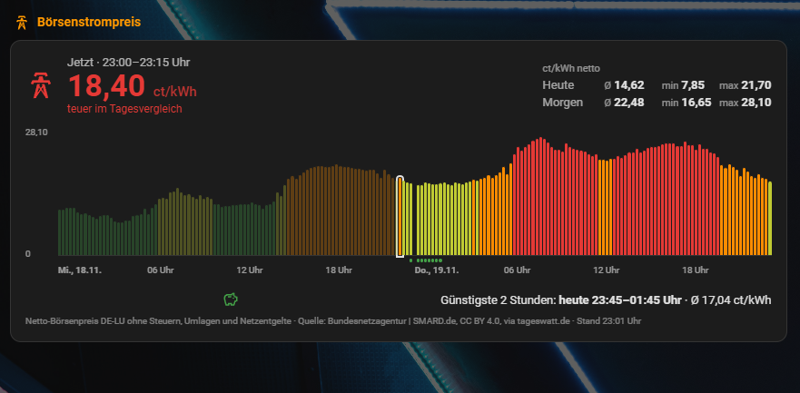

# Tageswatt API

Free API for German day-ahead electricity prices (bidding zone DE-LU) in 15-minute steps. No sign-up, no token, CORS enabled. Data since 1 October 2025, tomorrow's prices from about 13:00 German time.

Website: [tageswatt.de/daten](https://tageswatt.de/daten/) · [Deutsche Version](README.de.md)



*A Home Assistant card a user built with this API and shared anonymously.*

| Endpoint | What you get |
|---|---|
| [`/api/daten/aktuell.json`](https://tageswatt.de/api/daten/aktuell.json) | Price right now, stats for today and tomorrow, all quarter hours from today 00:00 to tomorrow 24:00 |
| [`/api/daten/preise.json?datum=2026-11-20`](https://tageswatt.de/api/daten/preise.json?datum=2026-11-20) | One day or a range as JSON |
| [`/api/daten/preise.csv?von=2026-11-01&bis=2026-11-15`](https://tageswatt.de/api/daten/preise.csv?von=2026-11-01&bis=2026-11-15) | One day or a range as CSV |

Base URL: `https://tageswatt.de`

## Ready-made configs

- [Home Assistant](examples/home-assistant/) (REST sensor and ApexCharts card)
- [evcc](examples/evcc/) (dynamic grid tariff)
- [Python](examples/python/) (cheapest hours of the day)

## `/api/daten/aktuell.json`

The fixed address for smart home systems. No date in the URL.

```json
{
  "quelle": "Bundesnetzagentur | SMARD.de, Lizenz CC BY 4.0, aufbereitet von tageswatt.de",
  "gebotszone": "DE-LU",
  "einheit": "ct/kWh netto, Börsenpreis ohne Steuern, Umlagen und Netzentgelte",
  "stand": "2026-11-26T19:15:16Z",
  "jetzt": { "start": "2026-11-26T19:15:00Z", "ende": "2026-11-26T19:30:00Z", "ct_kwh": 32.39 },
  "heute": { "datum": "2026-11-26", "verfuegbar": true, "mittel_ct_kwh": 29.18, "min_ct_kwh": 19.58, "max_ct_kwh": 38.8, "negative_minuten": 0 },
  "morgen": { "datum": "2026-11-27", "verfuegbar": true, "mittel_ct_kwh": 30.18, "min_ct_kwh": 20.34, "max_ct_kwh": 42.63, "negative_minuten": 0 },
  "werte": [
    { "start": "2026-11-25T23:00:00Z", "ende": "2026-11-25T23:15:00Z", "ct_kwh": 20.71 }
  ]
}
```

| Field | Meaning |
|---|---|
| `jetzt` | Current quarter hour, `null` if no data |
| `heute`, `morgen` | Daily mean, min and max in ct/kWh, minutes with negative prices. Before about 13:00, `morgen` is `{"datum": "...", "verfuegbar": false}` |
| `werte` | All quarter hours, times in UTC, prices in ct/kWh rounded to 2 decimals |

The response is cached until the next quarter hour, so `jetzt` is always current.

### Prices with grid fees and taxes: `?preis=brutto`

Add `?preis=brutto` and every `ct_kwh` value becomes an estimated end-customer price: exchange price plus grid fee, levies, electricity tax, concession fee and supplier margin, plus 19 % VAT. The structure of the response stays the same, so existing configs only need the new URL.

```
https://tageswatt.de/api/daten/aktuell.json?preis=brutto&netzentgelt=7.5&aufschlag=1.5
```

| Parameter | Meaning (ct/kWh net) | Default |
|---|---|---|
| `netzentgelt` | Grid fee of your network operator (price sheet or electricity bill) | 9.24, German average (BDEW 2026) |
| `konzession` | Concession fee, 1.32 to 2.39 depending on municipality size | 1.68, derived from the BDEW average |
| `aufschlag` | Supplier margin of your dynamic tariff | 2 |

Giving any of these implies `preis=brutto`. Levies and electricity tax are set per calendar year from official values. The response adds `jetzt.boerse_ct_kwh` and a `brutto` object listing every value used. Not included: the monthly base fee and time-variable grid fees under § 14a module 3.

## `/api/daten/preise.json` and `/api/daten/preise.csv`

Parameters: `datum=YYYY-MM-DD` for one day, or `von` and `bis` for a range. Without parameters you get today.

```json
{
  "quelle": "Bundesnetzagentur | SMARD.de, Lizenz CC BY 4.0, aufbereitet von tageswatt.de",
  "gebotszone": "DE-LU",
  "einheit": { "preis": "EUR/MWh", "ct_kwh": "ct/kWh netto" },
  "von": "2026-11-20",
  "bis": "2026-11-20",
  "werte": [
    { "start": "2026-11-19T23:00:00.000Z", "minuten": 15, "eur_mwh": 171.1, "ct_kwh": 17.11 }
  ]
}
```

CSV columns: `start_utc, datum, uhrzeit, minuten, eur_mwh, ct_kwh`. `datum` and `uhrzeit` are German local time.

```csv
start_utc,datum,uhrzeit,minuten,eur_mwh,ct_kwh
2026-11-19T23:00:00.000Z,2026-11-20,00:00,15,171.1,17.11
```

## Limits

- At most 31 days per request, from 2025-10-01 up to tomorrow.
- 60 requests per 10 minutes per IP. Above that you get HTTP 429. Polling `aktuell.json` every 5 minutes is fine.
- Errors come as `{"fehler": "..."}` with HTTP 400 or 429.

## What the price is (and is not)

These are wholesale exchange prices, net. Your actual tariff adds grid fees, levies, taxes and the supplier margin on top ([breakdown on tageswatt.de](https://tageswatt.de/strompreis-pro-kwh/)). For picking the cheapest hours that is fine as long as your surcharges are the same all day.

## Availability

The API is free and comes without any guarantee. It can fail or deliver data late. Format changes are announced on [tageswatt.de/daten](https://tageswatt.de/daten/) beforehand. If a failure would cost you money, plan a fallback, for example a fixed charging window.

## License and attribution

- **Data:** Bundesnetzagentur | SMARD.de, provided via Energy-Charts (Fraunhofer ISE), license [CC BY 4.0](https://creativecommons.org/licenses/by/4.0/). Please credit: **Bundesnetzagentur | SMARD.de, aufbereitet von tageswatt.de**.
- **Code and examples in this repository:** [MIT](LICENSE).

Questions or larger data needs: open an issue.
